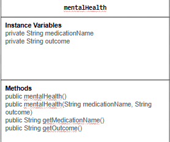

# data-for-social-good
# Unit 2 - Data for Social Good Project

## Introduction

Software engineers develop programs to work with data and provide information to a user. Each user has different needs based on the information they are looking for from data. Your goal is to create a data analysis program for your user that stores and analyzes data to provide the information they need.

## Requirements

Use your knowledge of object-oriented programming, one-dimensional (1D) arrays, and algorithms to create your data analysis program:
- **Write a class** – Write a class to represent your user or business and store and analyze their data with no-argument and parameterized constructors.
- **Create at least two 1D arrays** – Create at least two 1D arrays to store the data that your user needs information about.
- **Write a method** – Write a method that finds or manipulates the elements in a 1D array to provide the information your user needs.
- **Implement a toString() method** – Write a toString() method that returns general information about the data (for example, number of values in the dataset).
- **Document your code** – Use comments to explain the purpose of the methods and code segments and note any preconditions and postconditions.

## User Story 

Include your User Story you analyzed for your project here. Your User Story should have the following format: 

> As someone interested in mental health,   
> I want to see what treatment has the best outcome,   
> so that I can help my clients.

## Dataset 

Dataset:  https://www.kaggle.com/datasets/uom190346a/mental-health-diagnosis-and-treatment-monitoring 
- **Medication** (String) - name of the medication
- **Outcome** (String) - outcome after taking the medication

## UML Diagram 

 

## Description 

Our code was created using java in code.org. The User Story was created in mind with what kind of variables we could assign (Strings, int, double, boolean) and if we'd need a certain amount of classes. The chosen dataset was selected from Kaggle, which had a plethora of mental health datasets to choose from. It was made with the idea that someone who works in a field of mental health could use to see which medication would provide a better, overall affect. 